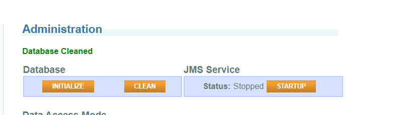

## System displays several random accounts when request loan amount with decimal value in down payment.

**Priority:** High
**Severity:** Critical
> #### This issue has a critical business impact as the system displays other accounts that don't belong to the user which is a major data integrity problem.

### Steps to Reproduce

> 1. Visit [ParaBank](https://parabank.parasoft.com/parabank).
> 2. Login with credentials DemoTestUser19118/Test12345##**
> 3. Go to "Admin Page" and click on "Clear" button under "Database" section.
> 4. Go to "Accounts Overview" page and record the existing balance. 
> 5. Request a new load with value "22" and down payment value "1" through "Request loan" page.
> 6. Go back to the accounts page and record the accounts and balances.
> 7. Request another loan with value "20" and down payment value "0.5".
> 8. Go back to accounts page.

### Expected Result

* After the first loan a new account should be displayed with the loan value.
* Original account should have the down payment value deducted.
* After the second loan 3 total accounts should be displayed.

### Actual Result

* When entered decimal value in the downpayment system displayed multiple random accounts not opened by the user.

### Screenshots

