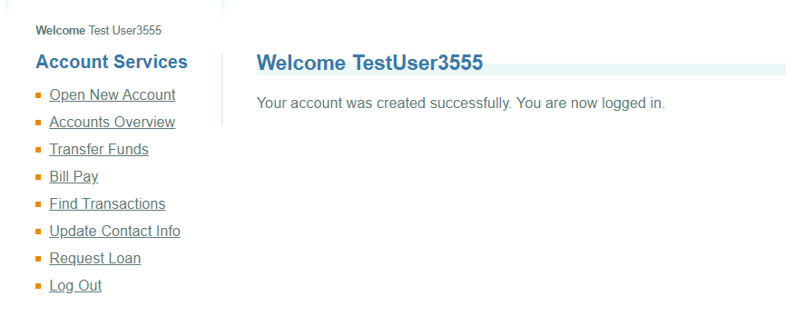

## Registered users are lost from the system after first logout.

**Priority:** High
**Severity:** Critical
> #### This issue has a critical business impact as the user gets completely lost.

### Steps to Reproduce

'''
**Note:** Below steps are not consistenlty reproducible.
'''

> 1. Visit [ParaBank](https://parabank.parasoft.com/parabank).
> 2. Register new user with credentials DemoTestUser19118/Test12345##**
> 3. Go to "Admin Page" and click on "Clear" button under "Database" section.
> 4. Go to "Accounts Overview" page and record the existing balance.
> 5. Transfer a fund to the same account.
> 6. Go back to the accounts page and record the accounts and balances.
> 7. Logout
> 8. Login again with same credentials.

### Expected Result

* User would be logged in normally.
* User accounts will be displayed.

### Actual Result

* User not found, sometimes when try after a while or the next day user returns randomly then disappears again.

### Screenshots

