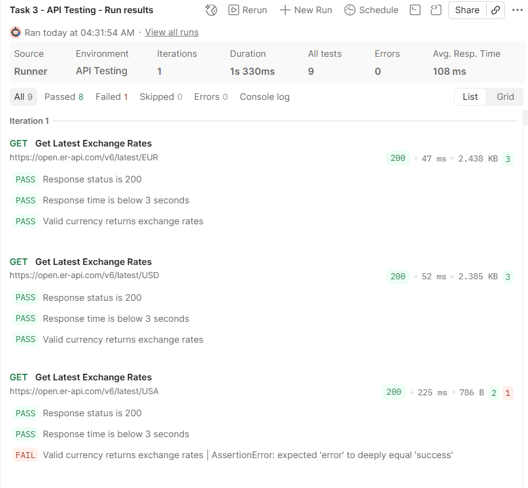

> - #### Kindly note that using data files in Postman requires a paid plan.
> - #### As an alternative, I've defined an array of strings in the test script to iterate through the test data when running the collection.

### Test Scenarios and Validations

| Scenario             | Validations                                                                                                                |
| -------------------- | -------------------------------------------------------------------------------------------------------------------------- |
| Valid currency (EUR) | Verify **HTTP 200**, response time below 3 seconds, successful response, correct base currency, and exchange rates object. |
| Valid currency (USD) | Verify **HTTP 200**, response time below 3 seconds, successful response, correct base currency, and exchange rates object. |
| Invalid currency     | Verify **HTTP 200**, response time below 3 seconds, and an error response.                                                 |

### Collection Run Results

